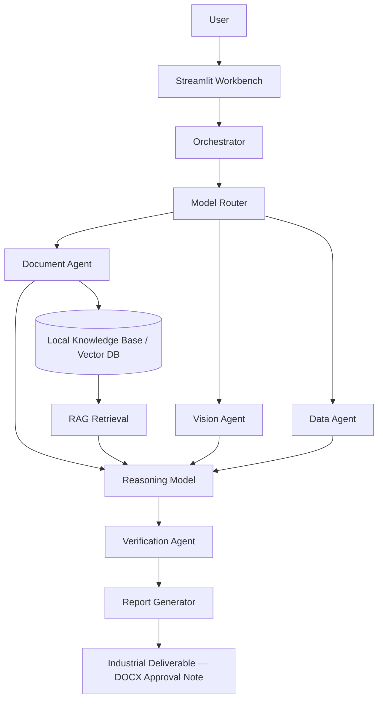

# Sovereign AI Workbench

**SIH26117 — Sovereign On-Premise Agentic AI Workbench using Open-Weight Multimodal LLMs for Confidential Industrial Work**
Organization: MRPL | Smart India Hackathon 2026

A private, on-premise AI execution environment where confidential industrial
documents, images, and operational data are analyzed by coordinated AI
agents — without the data needing to leave organization-controlled
infrastructure.

---

## 1. Problem

Industrial organizations generate large volumes of sensitive information —
inspection reports, engineering drawings, sensor logs, maintenance manuals,
internal correspondence. Sending this data to a general-purpose cloud AI
service is often unsuitable for confidential or regulated environments.

## 2. Solution

A sovereign AI workbench where:

- Documents, images, and sensor data are processed **locally**.
- Multiple **specialized agents** (document, vision, data, reasoning,
  verification, report) are coordinated by an **orchestrator**.
- Answers are grounded in an organization's own knowledge base via **RAG**,
  not just model memory.
- A **verification layer** checks whether conclusions are actually supported
  by evidence before they reach a human reviewer.
- The output is a real deliverable — a DOCX approval note — not just a chat
  reply.

This is **not** a general-purpose chatbot, and it does not claim to replace
one. It is positioned as a sovereign AI execution environment for
organizations where confidential industrial data must remain under
organizational control.

## 3. Architecture



**Pipeline for the reference demo task:**

```
USER
 ↓
WORKBENCH UI
 ↓
ORCHESTRATOR  (decomposes task, selects required agents)
 ↓
DOCUMENT AGENT      → PDF text extraction (PyMuPDF)
 ↓
RAG / KNOWLEDGE AGENT → chunk → embed → ChromaDB → semantic retrieval
 ↓
VISION AGENT        → image condition observations
 ↓
DATA AGENT          → pandas/numpy sensor analysis, threshold checks
 ↓
REASONING ENGINE    → combines evidence, tags FACT / OBSERVATION / INFERENCE / RECOMMENDATION
 ↓
VERIFICATION AGENT  → flags/softens claims unsupported by evidence
 ↓
REPORT GENERATOR    → DOCX approval note (python-docx)
```

## 4. Agents

| Agent | Responsibility |
|---|---|
| Document Agent | Extracts and chunks text from uploaded PDFs |
| RAG / Knowledge Agent | Indexes documents into a local vector store; retrieves relevant evidence for the query |
| Vision Agent | Analyzes equipment images for visible condition indicators |
| Data Agent | Profiles CSV sensor data; flags threshold exceedances and statistical anomalies |
| Reasoning Engine | Combines all evidence into a structured, evidence-tagged assessment |
| Verification Agent | Checks claims against evidence; softens or flags unsupported statements |
| Report Agent | Generates the final DOCX approval note |

Agents call **tools** (`tools/`, `rag/`) rather than embedding heavy logic
themselves — this keeps the system modular and easy to extend with new
agents or tools.

## 5. RAG (Retrieval-Augmented Generation)

```
Documents → Text Extraction (PyMuPDF) → Chunking → Embeddings → ChromaDB → Semantic Search → Reasoning Model
```

- **Embeddings**: `sentence-transformers` (`all-MiniLM-L6-v2`) when available.
  If model weights cannot be downloaded (e.g. a fully offline/air-gapped
  deployment that hasn't pre-cached the model), the system automatically
  falls back to a deterministic, fully local hashing-based embedding
  (scikit-learn `HashingVectorizer`) — RAG keeps working with **zero
  external calls**, at reduced semantic quality. Check the Security page to
  see which mode is active.
- **Vector store**: ChromaDB, persisted on disk under `data/vector_db/`.
- Retrieved evidence is shown in the UI with document name, page number, and
  a similarity score, and is directly cited in the generated report.

## 6. Multimodal Processing

| Input | Handling |
|---|---|
| PDF | PyMuPDF text extraction → chunking → RAG indexing |
| Image (JPG/PNG) | Vision adapter — local multimodal model if configured, otherwise a clearly labeled heuristic demo fallback (Pillow edge/darkness statistics) |
| CSV | pandas/numpy statistical profiling, threshold checks, z-score anomaly detection, Plotly trend charts |

The vision fallback is **never presented as a trained industrial diagnostic
model** — the UI and generated report both label demo-mode findings as such.

## 7. Model Routing

`core/model_router.py` maps task types (`reasoning`, `vision`,
`verification`, `document_summarization`) to a configured model. This is
configuration-based for the MVP, not a benchmarking system, but the
interface (`models/base_model.py`) means a new open-weight model (Qwen,
Llama, Mistral, etc., served locally e.g. via Ollama) can be plugged in by
implementing `BaseModel` — no agent code changes needed.

Set in `.env`:

```
LOCAL_LLM_MODE=local
LOCAL_LLM_ENDPOINT=http://localhost:11434
LOCAL_LLM_MODEL_NAME=qwen2.5:7b-instruct
```

If `LOCAL_LLM_MODE=mock` (default) or the local endpoint is unreachable, the
system runs in a clearly labeled demo/mock mode instead of crashing.

## 8. Verification Layer

The Verification Agent checks whether reasoning-agent claims are supported
by available evidence. Overconfident or unsupported phrasing (e.g. "will
fail within 2 hours", "guaranteed", "100%") is detected and either flagged
or softened into an evidence-appropriate statement, e.g.:

> "Available evidence indicates abnormal operating conditions, but the
> provided data does not support a precise failure-time prediction."

This is reported in the UI and DOCX report as:

```
✓ Claims supported: 5
⚠ Claims requiring caution: 1
✓ Sources available: 3
```

## 9. Security / Sovereignty Status

The Security page (`ui/security.py`, `security/security_status.py`) reports,
**honestly**, whether each subsystem is running locally or in a
demo/mock/fallback mode — it never claims a physically verified air gap
unless the deployment environment is independently isolated. It reports
configured intent (e.g. "no external API is configured"), not a guarantee.

## 10. Installation

```bash
python -m venv .venv

# Windows
.venv\Scripts\activate

# macOS/Linux
source .venv/bin/activate

pip install -r requirements.txt
cp .env.example .env   # edit as needed
```

## 11. Running Locally

```bash
streamlit run app.py
```

Then open the URL Streamlit prints (typically `http://localhost:8501`).

To generate the bundled demo dataset (or regenerate it):

```bash
python demo/generate_demo_data.py
```

## 12. Demo Workflow

1. Click **▶ RUN INDUSTRIAL DEMO** on the New Task page — this loads the
   bundled `inspection_report.pdf`, `maintenance_manual.pdf`,
   `sensor_data.csv`, and `equipment_image.jpg`, and runs the full pipeline.
2. Watch the **AI Execution Pipeline** update live as each agent runs.
3. Review the **Maintenance Status** result card and the **Why?** evidence
   list.
4. Download the generated **Approval Note (DOCX)**.
5. Visit the **Knowledge Base**, **Data Analysis**, **Vision Analysis**,
   **Agents**, and **Security** pages to show the underlying evidence and
   architecture.

Or upload your own PDF/CSV/image files and describe a task in free text.

## 13. Testing

```bash
pytest tests/ -v
```

Covers RAG indexing/retrieval, individual agents (document, data, vision,
verification), and the full orchestrator pipeline end-to-end using the demo
dataset.

## 14. Project Structure

```
sovereign_ai_workbench/
├── app.py                  # Streamlit entry point
├── config/settings.py      # Central configuration
├── ui/                     # Dashboard, documents, knowledge, agents, analysis, reports, security, styles
├── core/                   # Orchestrator, model router, task/state management
├── agents/                 # Document, Vision, Data, Reasoning, Verification, Report agents
├── rag/                    # Loader, chunker, embeddings, vector store, retriever, pipeline
├── tools/                  # PDF, CSV, chart, report, file, analysis tool functions
├── models/                 # Model abstraction (local LLM, vision, optional API fallback)
├── security/                # Network monitor, security status, audit log
├── data/                   # Uploaded/generated data (documents, images, csv, vector_db, reports)
├── demo/                   # Synthetic demo dataset + generator script
└── tests/                  # pytest suite
```

## 15. Limitations (Current MVP)

- Reasoning quality depends on the configured LLM; in mock mode, reasoning
  narrative is templated from structured evidence rather than free-form
  model generation.
- Vision analysis in fallback mode uses basic image statistics, not a
  trained defect-detection model.
- Model router is configuration-based, not a learned/benchmarked routing
  system.
- Not yet physically air-gapped — sovereignty here reflects application
  configuration and architecture, not a certified isolated deployment.

## 16. Future Scope

- Additional industrial agents (SQL/database agent, engineering calculation
  tools, coding agent).
- Advanced multimodal models for higher-fidelity vision analysis.
- Role-based permissions and richer audit trails.
- Formal model evaluation harness for routing decisions.
- Fully air-gapped, independently verified deployment target.
- Domain-specific fine-tuned models per industry vertical.

---

*Generated content in this workbench is AI-assisted and requires human
review and approval before operational use.*
